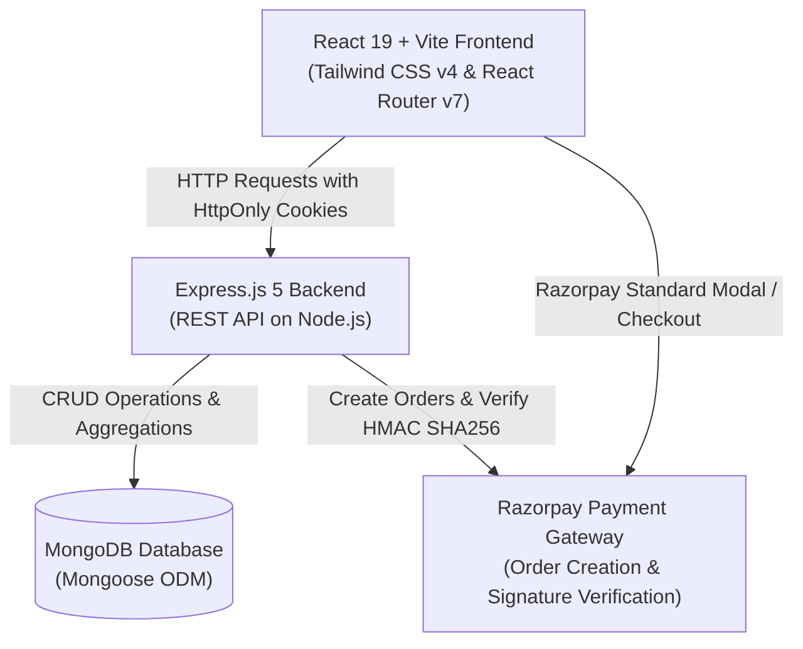

# 🛒 ShopKart — Full-Stack MERN E-Commerce Platform

[](https://nodejs.org/)
[](https://expressjs.com/)
[](https://react.dev/)
[](https://vitejs.dev/)
[](https://www.mongodb.com/)
[](https://tailwindcss.com/)
[](https://razorpay.com/)

ShopKart is a modern, high-performance full-stack e-commerce web application built using the **MERN stack** (MongoDB, Express.js, React, Node.js). It provides an end-to-end shopping experience featuring secure cookie-based JWT authentication, real-time cart and wishlist synchronization, inventory tracking, and full **Razorpay payment gateway integration** with cryptographic signature verification.

---

## 📑 Table of Contents

- [Architecture & System Design](#-architecture--system-design)
- [Key Features](#-key-features)
- [Tech Stack](#-tech-stack)
- [Directory Structure](#-directory-structure)
- [Getting Started](#-getting-started)
  - [Prerequisites](#prerequisites)
  - [1. Backend Setup](#1-backend-setup)
  - [2. Frontend Setup](#2-frontend-setup)
- [Environment Variables](#-environment-variables)
- [REST API Reference](#-rest-api-reference)
  - [Authentication & Customer (`/customers`)](#authentication--customer-customers)
  - [Products (`/products`)](#products-products)
  - [Cart (`/cart`)](#cart-cart)
  - [Wishlist (`/wishlist`)](#wishlist-wishlist)
  - [Orders & Checkout (`/orders`)](#orders--checkout-orders)
- [Razorpay Payment Lifecycle](#-razorpay-payment-lifecycle)
- [Security & Reliability](#-security--reliability)
- [License](#-license)

---

## 🏛 Architecture & System Design



---

## ✨ Key Features

### 🔐 1. Authentication & Customer Management
- **Secure Registration & Login**: User registration with email uniqueness, strong password hashing using `bcrypt`.
- **HttpOnly Cookie Authentication**: JWT access tokens are set in `HttpOnly`, `SameSite` cookies to mitigate XSS vulnerabilities.
- **Profile Management**: Retrieve logged-in profile data (`/customers/me`) and update passwords securely (`/customers/change-password`).
- **Protected Routing**: React client-side route guards prevent unauthorized access to private pages.

### 🛍 2. Product Catalog & Discovery
- **Dynamic Catalog**: Browse products with responsive card layouts, price display, category tags, and real-time stock status.
- **Detailed Product View**: High-resolution imagery, item descriptions, and direct actions to add to cart or wishlist.
- **Stock Management**: Inventory levels tracked in MongoDB and decremented upon verified order completion.

### ❤️ 3. Wishlist Management
- **One-Click Toggle**: Add or remove items from wishlist with instant feedback.
- **Persistent Storage**: User wishlists persist in MongoDB and synchronize across sessions.
- **Navbar Badge**: Dynamic count indicator in the navigation header.

### 🛒 4. Real-time Cart System
- **State Management**: Built on React Context API (`CartContext`) for instant, optimistic UI updates.
- **Item Controls**: Adjust quantities, remove items, and see calculations update automatically.
- **Price Calculation**: Subtotal, taxes, shipping, and total breakdown with real-time recalculation.

### 💳 5. Checkout & Razorpay Integration
- **Shipping Address Form**: Comprehensive validation for recipient details, address lines, city, state, and pin code.
- **Server-Side Order Generation**: Prevents client tampering by calculating prices directly from MongoDB product prices before creating Razorpay orders in paise.
- **Razorpay Modal Checkout**: Smooth popup gateway supporting test credit/debit cards, UPI, and net banking.
- **Cryptographic Signature Verification**: Server computes `HMAC-SHA256` hash of `order_id|payment_id` with `RAZORPAY_KEY_SECRET` before confirming the order.
- **Automated Cart Reset**: Cart automatically flushes upon verified payment confirmation.

### 📦 6. Order Tracking & Receipts
- **Order History**: Review previous purchases, order dates, payment status (`PENDING`, `PAID`, `SHIPPED`, `DELIVERED`), and total amounts.
- **Receipt Details**: Dedicated order detail screen displaying ordered items, unit prices, delivery addresses, and payment IDs.

---

## 🛠 Tech Stack

### Frontend
| Technology | Description |
|---|---|
| **React 19** | Modern component-based user interface library |
| **Vite** | Blazing fast development server and build tool |
| **React Router DOM v7** | Client-side routing and protected routes |
| **Tailwind CSS v4** | Modern utility-first CSS framework |
| **Axios** | Promise-based HTTP client configured with credentials |
| **Razorpay Checkout.js** | Client SDK for handling payments modal |

### Backend
| Technology | Description |
|---|---|
| **Node.js** | JavaScript runtime environment |
| **Express.js v5** | Fast, unopinionated REST API framework |
| **MongoDB & Mongoose v8** | NoSQL document database and object data modeling |
| **jsonwebtoken (JWT)** | Token-based stateless authentication |
| **bcrypt** | Adaptive password hashing function |
| **cookie-parser** | Parse and sign HttpOnly cookie headers |
| **razorpay** | Official Razorpay Node.js SDK |
| **cors** | Configured for credentialed cross-origin requests |

---

## 📁 Directory Structure

```text
Shopkart/
├── backend/
│   ├── config/
│   │   └── razorpay.js           # Razorpay SDK initialization
│   ├── controllers/
│   │   ├── auth.controller.js     # Legacy auth wrapper
│   │   ├── cart.controller.js     # Cart CRUD & calculations
│   │   ├── customer.controller.js # Register, login, profile, password change
│   │   ├── order.controller.js    # Razorpay order creation, verification, history
│   │   ├── product.controller.js  # Product listing & details
│   │   └── wishlist.controller.js # Wishlist toggle, add, remove
│   ├── middlewares/
│   │   └── auth.middleware.js     # JWT verification from HttpOnly cookie
│   ├── models/
│   │   ├── customer.model.js      # Customer schema with cart & wishlist sub-documents
│   │   ├── order.model.js         # Order schema with address & payment metadata
│   │   ├── product.model.js       # Product schema with stock and pricing
│   │   └── user.model.js          # Admin/User model reference
│   ├── routes/
│   │   ├── auth.routes.js
│   │   ├── cart.routes.js
│   │   ├── customer.routes.js
│   │   ├── order.routes.js
│   │   ├── product.routes.js
│   │   └── wishlist.routes.js
│   ├── utils/
│   │   └── generateToken.js       # JWT cookie generation utility
│   ├── .env.example              # Sample environment template
│   ├── index.js                  # Express application entrypoint
│   └── package.json
│
├── shopkart-frontend/
│   ├── public/                   # Static icons and assets
│   ├── src/
│   │   ├── assets/               # Images and SVGs
│   │   ├── components/
│   │   │   ├── CartItem.jsx      # Individual cart item row with quantity buttons
│   │   │   ├── CheckoutForm.jsx  # Shipping details input form
│   │   │   ├── Navbar.jsx        # Navigation bar with badges and user menu
│   │   │   ├── OrderCard.jsx     # Order summary card in orders list
│   │   │   ├── OrderSummary.jsx  # Price breakdown summary
│   │   │   ├── ProductCard.jsx   # Product grid card
│   │   │   ├── ProtectedRoute.jsx# Auth wrapper redirecting to /login
│   │   │   └── WishlistCard.jsx  # Wishlist item card
│   │   ├── context/
│   │   │   └── CartContext.jsx   # Global cart & wishlist context
│   │   ├── pages/
│   │   │   ├── Cart.jsx          # Shopping cart page
│   │   │   ├── Checkout.jsx      # Checkout & Razorpay payment trigger
│   │   │   ├── Home.jsx          # Landing page
│   │   │   ├── Login.jsx         # Customer login page
│   │   │   ├── OrderDetails.jsx  # Single order invoice view
│   │   │   ├── Orders.jsx        # User order history
│   │   │   ├── OrderSuccess.jsx  # Post-payment confirmation view
│   │   │   ├── ProductDetails.jsx# Detailed product view
│   │   │   ├── Products.jsx      # Main catalog page
│   │   │   ├── Profile.jsx       # Customer profile view
│   │   │   ├── Register.jsx      # Customer registration page
│   │   │   └── Wishlist.jsx      # Saved wishlist page
│   │   ├── services/
│   │   │   ├── api.js            # Axios client with baseURL and credentials
│   │   │   └── razorpay.js       # Razorpay checkout script loader
│   │   ├── App.jsx               # Routes definition
│   │   ├── index.css             # Tailwind CSS styles
│   │   └── main.jsx              # React root entry point
│   ├── vite.config.js
│   └── package.json
│
├── .gitignore
└── README.md
```

---

## 🚀 Getting Started

### Prerequisites
Make sure you have the following installed on your machine:
- [Node.js](https://nodejs.org/) (version 18 or 20+ recommended)
- [Git](https://git-scm.com/)
- A running [MongoDB](https://www.mongodb.com/) instance (locally or on MongoDB Atlas)
- A [Razorpay](https://dashboard.razorpay.com/) account (Test mode Key ID and Key Secret)

---

### 1. Backend Setup

1. Open a terminal and navigate to the backend directory:
   ```bash
   cd backend
   ```

2. Install backend dependencies:
   ```bash
   npm install
   ```

3. Create your `.env` file based on `.env.example`:
   ```bash
   cp .env.example .env
   ```

4. Populate the `.env` file with your credentials:
   ```env
   PORT=5000
   MONGO_URI=mongodb+srv://<username>:<password>@cluster0.example.mongodb.net/shopkart?retryWrites=true&w=majority
   JWT_SECRET=super_secret_jwt_key_at_least_32_characters
   RAZORPAY_KEY_ID=rzp_test_YourKeyIdHere
   RAZORPAY_KEY_SECRET=YourKeySecretHere
   ```

5. Start the backend server:
   ```bash
   npm start
   ```
   The backend API will run on `http://localhost:5000`.

---

### 2. Frontend Setup

1. Open a new terminal and navigate to the frontend directory:
   ```bash
   cd shopkart-frontend
   ```

2. Install dependencies:
   ```bash
   npm install
   ```

3. Start the Vite development server:
   ```bash
   npm run dev
   ```
   The application will be live at `http://localhost:5173`.

---

## ⚙ Environment Variables

### Backend (`backend/.env`)

| Variable | Required | Description | Example |
|---|---|---|---|
| `PORT` | Optional | Port the Express server listens on | `5000` |
| `MONGO_URI` | **Yes** | MongoDB connection connection string | `mongodb://localhost:27017/shopkart` |
| `JWT_SECRET` | **Yes** | Secret key used for signing JWT cookies | `random_long_secret_hash` |
| `RAZORPAY_KEY_ID` | **Yes** | Razorpay Test/Live Key ID | `rzp_test_xxxxxxx` |
| `RAZORPAY_KEY_SECRET` | **Yes** | Razorpay Test/Live Key Secret | `yyyyyyy` |

---

## 📡 REST API Reference

All requests returning data respond with JSON. Protected endpoints require the `token` cookie set during authentication.

### Authentication & Customer (`/customers`)

| Method | Endpoint | Access | Description |
|---|---|---|---|
| `POST` | `/customers/register` | Public | Register a new customer |
| `POST` | `/customers/login` | Public | Login customer and receive HttpOnly cookie |
| `GET` | `/customers/me` | Protected | Get profile details of the authenticated customer |
| `POST` | `/customers/logout` | Protected | Clear authentication cookie |
| `PATCH` | `/customers/change-password` | Protected | Change password by verifying old password |

#### Register Request Body:
```json
{
  "fullName": "Jane Doe",
  "email": "jane@example.com",
  "password": "strongPassword123",
  "phone": "9876543210"
}
```

#### Login Request Body:
```json
{
  "email": "jane@example.com",
  "password": "strongPassword123"
}
```

---

### Products (`/products`)

| Method | Endpoint | Access | Description |
|---|---|---|---|
| `GET` | `/products` | Public | Fetch all available products |
| `GET` | `/products/:id` | Public | Fetch details of a specific product by ID |
| `POST` | `/products` | Admin/Public | Create a new product entry |

#### Create Product Body:
```json
{
  "name": "Wireless Noise Cancelling Headphones",
  "description": "High fidelity audio with 30-hour battery life",
  "price": 4999,
  "category": "Electronics",
  "image": "https://example.com/headphones.jpg",
  "stock": 25
}
```

---

### Cart (`/cart`)

| Method | Endpoint | Access | Description |
|---|---|---|---|
| `GET` | `/cart` | Protected | Retrieve authenticated user's cart and item totals |
| `POST` | `/cart/:productId` | Protected | Add a product to cart (or increment if exists) |
| `PATCH` | `/cart/:productId` | Protected | Update quantity (`{ "quantity": 3 }`) |
| `DELETE` | `/cart/:productId` | Protected | Remove product completely from cart |

---

### Wishlist (`/wishlist`)

| Method | Endpoint | Access | Description |
|---|---|---|---|
| `GET` | `/wishlist` | Protected | Retrieve all items in user's wishlist |
| `POST` | `/wishlist/:productId` | Protected | Add an item to wishlist |
| `DELETE` | `/wishlist/:productId` | Protected | Remove an item from wishlist |
| `PATCH` | `/wishlist/:productId/toggle`| Protected | Toggle presence of product in wishlist |

---

### Orders & Checkout (`/orders`)

| Method | Endpoint | Access | Description |
|---|---|---|---|
| `POST` | `/orders/create-payment-order` | Protected | Validates stock, calculates total, creates Razorpay order |
| `POST` | `/orders/verify-payment` | Protected | Verifies HMAC signature, confirms order & clears cart |
| `GET` | `/orders` | Protected | Retrieve list of all orders placed by user |
| `GET` | `/orders/:id` | Protected | Retrieve details of a specific order |
| `PATCH`| `/orders/:id/status` | Protected | Update order fulfillment status |

---

## 💳 Razorpay Payment Lifecycle

The payment flow guarantees that prices cannot be manipulated from the browser console or network inspect tools:

1. **Initiate Checkout**: The frontend submits the validated shipping address to `POST /orders/create-payment-order`.
2. **Server-Side Price Calculation**:
   - The server inspects the customer's current cart in the database.
   - It fetches the actual prices and stock levels directly from the `Product` collection.
   - It computes the total in INR and converts it to **paise** (`total * 100`).
3. **Razorpay Order Creation**: The backend calls Razorpay SDK to create an order:
   ```javascript
   const razorpayOrder = await razorpay.orders.create({
     amount: amountInPaise,
     currency: "INR",
     receipt: `order_rcptid_${Date.now()}`
   });
   ```
4. **Client Modal**: The frontend launches the Razorpay Checkout modal with the returned `order_id` and test key.
5. **Payment Completion & Callback**: When payment succeeds, Razorpay returns:
   - `razorpay_order_id`
   - `razorpay_payment_id`
   - `razorpay_signature`
6. **Signature Verification**:
   The frontend forwards these tokens to `POST /orders/verify-payment`. The backend verifies the cryptographic signature:
   ```javascript
   const body = razorpay_order_id + "|" + razorpay_payment_id;
   const expectedSignature = crypto
     .createHmac("sha256", process.env.RAZORPAY_KEY_SECRET)
     .update(body.toString())
     .digest("hex");
   ```
7. **Order Finalization**:
   - Status transitions to `PAID`.
   - Inventory stock in the `Product` collection is decremented.
   - The user's cart in `Customer` is automatically cleared.

---

## 🔒 Security & Reliability

- **HttpOnly Cookies**: Prevents client-side scripts from reading authentication tokens, blocking cookie theft via XSS attacks.
- **Bcrypt Salting**: Passwords are saved with adaptive salt rounds; plain text passwords are never stored or returned by queries (`select: false`).
- **Input Validation**: Form checks for email regex, 10-digit phone numbers, and required address fields prevent dirty writes.
- **Inventory Concurrency Guard**: Stock availability is validated before order generation to prevent overselling.
- **Tamper-Proof Billing**: Client cart item prices are ignored during checkout; totals are computed strictly from database records.

---

## 📄 License

This project is licensed under the [MIT License](LICENSE). Feel free to use and adapt it for your learning and commercial projects.
